<div align="center">

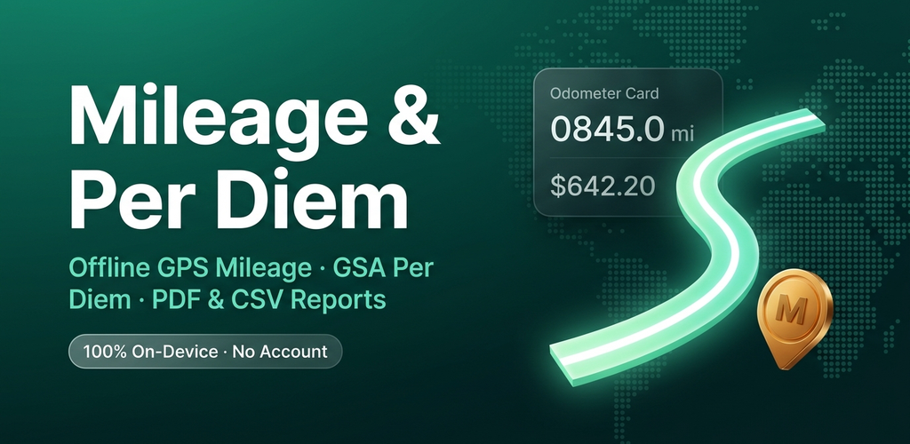

# Mileage & Per Diem

**An offline-first Android app that logs business drives with GPS, prices them at the IRS rate in effect on the day, adds U.S. government per diems, and exports expense reports. Everything stays on the phone.**

By **AI.Jones** · Kotlin · Jetpack Compose · MVVM · Coroutines/Flow · Hilt · Room · Navigation 3


[](docs/README.md)

</div>

> ### The 30-second version
> - **A real product problem with real constraints.** It records GPS drives under Google Play's location policy (no background location), costs them at an IRS rate that **changed mid-year** (72.5¢ → 76¢ on Jul 1, 2026), and bundles **real FY2027 GSA per diem rates** for 298 locations, all without a backend.
> - **Production-grade Android architecture.** 37 feature modules in clean-architecture layers, use cases, unidirectional data flow, Hilt and Navigation 3, with the dependency rules enforced in the build.
> - **Measured performance.** **272 ms** cold start (median, Baseline Profile), checked by Macrobenchmark against a **600 ms budget the build enforces**, and a **3.0 MB** release APK.
> - **Craft and quality.** A designed odometer, route replay, slide-to-end, a printed receipt, a swipe deck, story cards, home-screen widgets and a Quick Settings tile. **279 behaviour tests using fakes**, on-device analytics with an app-health dashboard, and feature flags.
> - **A modern way of working.** Designed in FigCraft first and decided in 18 ADRs, then built by parallel coding agents working under written rules (`AGENTS.md`) and checked screen by screen on an emulator.

---

## The app, running
<sub>Screenshots from the API 36 emulator.</sub>

<table>
  <tr>
    <td align="center" width="25%">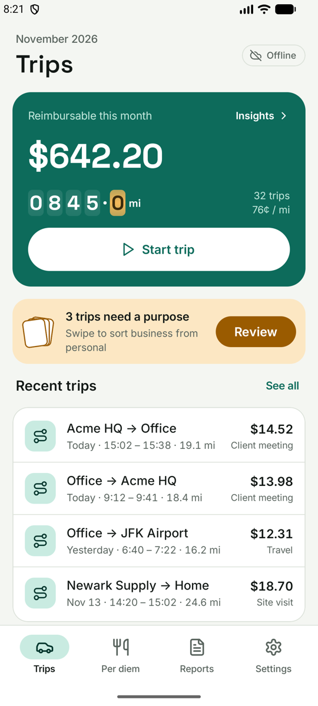<br/><sub><b>Home</b> · odometer, month total</sub></td>
    <td align="center" width="25%"><br/><sub><b>Live trip</b> · slide to end</sub></td>
    <td align="center" width="25%">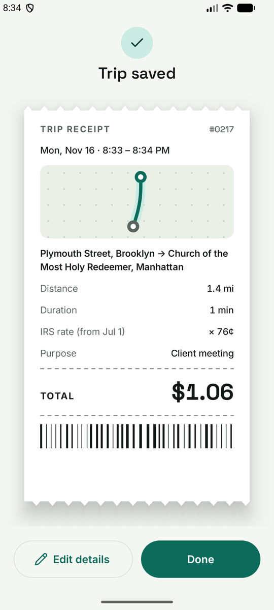<br/><sub><b>Receipt</b> · a real 1.4 mi drive</sub></td>
    <td align="center" width="25%">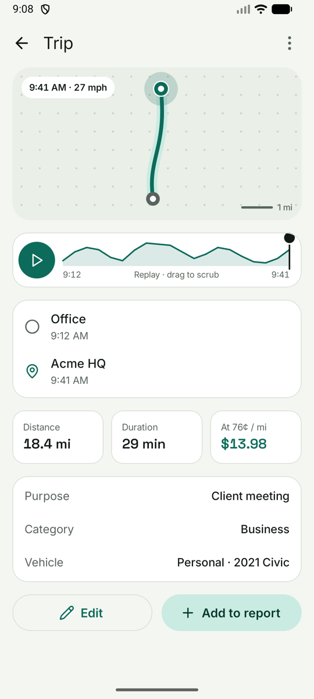<br/><sub><b>Route replay</b> · speed scrubber</sub></td>
  </tr>
  <tr>
    <td align="center"><br/><sub><b>Swipe to sort</b> business vs personal</sub></td>
    <td align="center">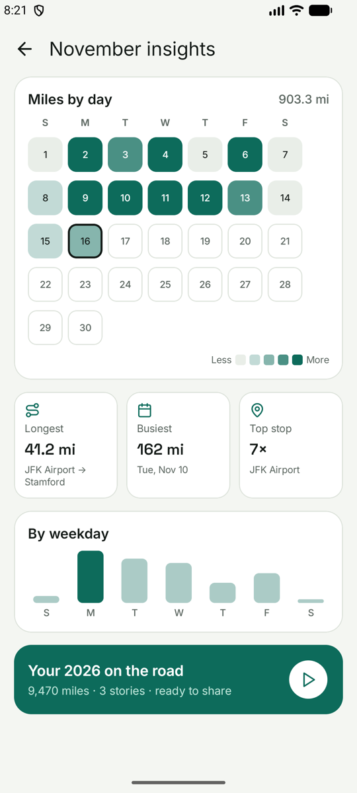<br/><sub><b>Insights</b> · miles heatmap</sub></td>
    <td align="center">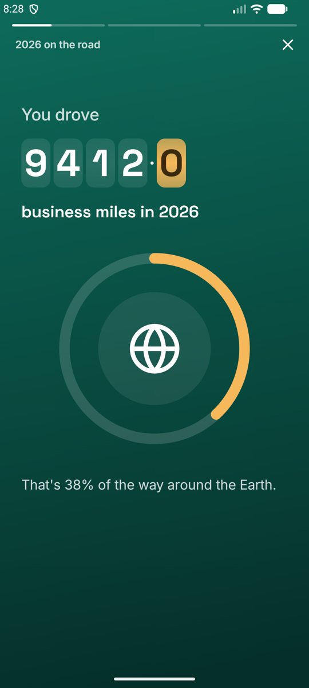<br/><sub><b>2026 on the road</b> · story cards</sub></td>
    <td align="center">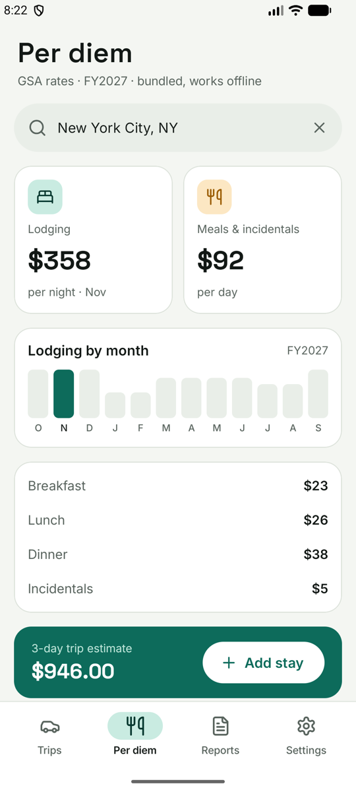<br/><sub><b>GSA per diem</b> · bundled FY2027</sub></td>
  </tr>
  <tr>
    <td align="center">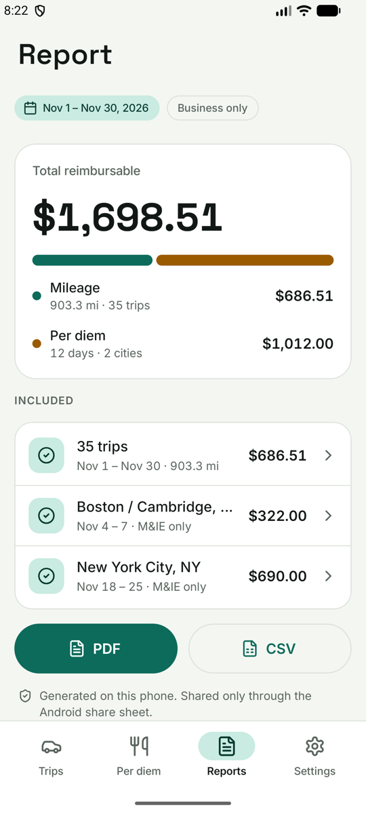<br/><sub><b>Report</b> · PDF &amp; CSV export</sub></td>
    <td align="center">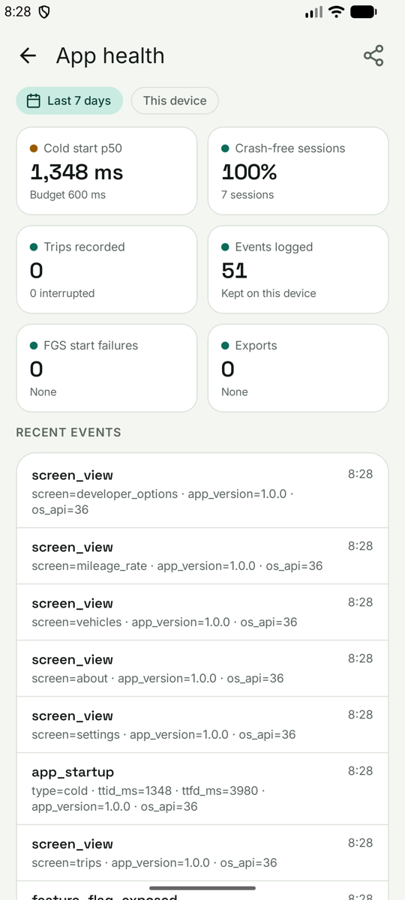<br/><sub><b>App health</b> · on-device analytics</sub></td>
    <td align="center"><br/><sub><b>Dark theme</b> · every screen</sub></td>
    <td align="center">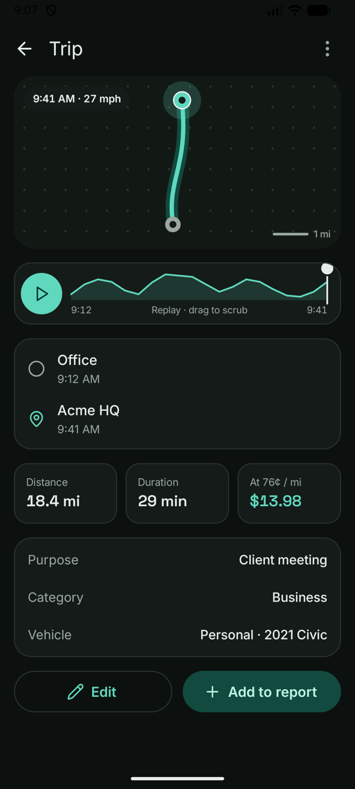<br/><sub><b>Dark</b> · trip detail</sub></td>
  </tr>
</table>

<table>
  <tr>
    <td align="center" width="50%">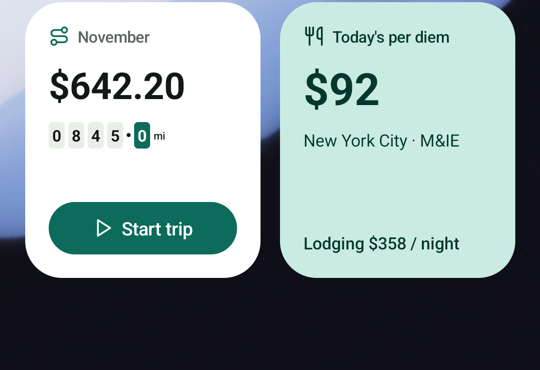<br/><sub><b>Glance widgets</b> · month total, today's per diem (plus a Quick Settings tile)</sub></td>
    <td align="center" width="50%">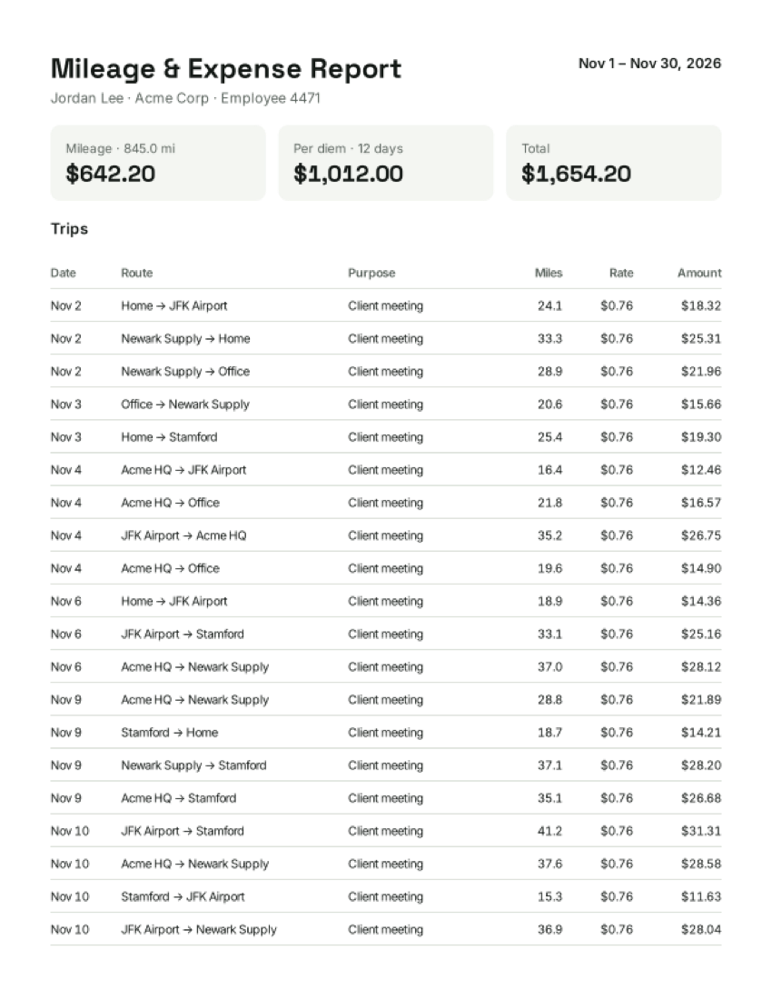<br/><sub><b>PDF report</b> · drawn with the platform <code>PdfDocument</code> API, no library</sub></td>
  </tr>
</table>

---

## Engineering deep dives
Short write-ups, each in the folder whose code it explains:

| | Topic | What it shows |
|---|---|---|
| 🧱 | [**Architecture: feature modules × clean layers**](feature/README.md) | 37 modules, enforced dependency rules, use cases, UDF, Navigation 3, Hilt |
| 📍 | [**Trip recording that passes Play review**](feature/tracking/README.md) | Location foreground service, battery-aware sampling, GPS filtering, process-death recovery, permission guard |
| 💵 | [**Money, distance and rates that change mid-year**](core/model/README.md) | `Long` micro-dollars, effective-dated IRS rates, per-trip rate snapshot, GSA 75% rule |
| 🗄️ | [**Offline GSA per diem via a build-time OpenAPI import**](tools/perdiem-import/README.md) | Contract-first client → 168 KB SQLite asset → Room `createFromAsset` + FTS4 |
| 🎨 | [**From FigCraft design to Compose**](core/designsystem/README.md) | Design tokens, components, odometer, route canvas, slide-to-end, receipt, accessibility |
| ⚡ | [**Performance: a startup budget the build enforces**](benchmark/README.md) | Macrobenchmark, Baseline + startup profiles, a 600 ms gate, 3.0 MB APK |
| 📊 | [**Analytics, app health and feature flags without a backend**](core/analytics/README.md) | Typed events, ring-buffer sink, dashboard spec, flags with overrides |
| 🧪 | [**Testing behaviour with fakes, not mocks**](core/testing/README.md) | 279 tests by layer, `testFixtures` fakes, Turbine, Robolectric Compose tests |
| 🤖 | [**How it was built: design-first, with coding agents**](docs/README.md) | Research → designs → ADRs → rules for agents → parallel feature agents → device checks |

---

## Architecture at a glance
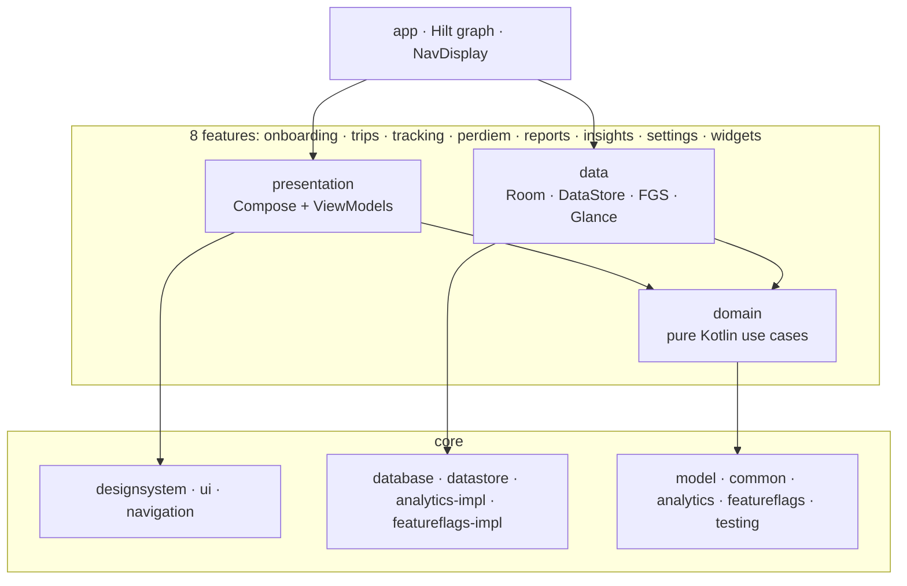

| Concern | Choice |
|---|---|
| UI | Jetpack Compose, Material 3, a custom design system, edge-to-edge, predictive back |
| Presentation | MVVM + UDF: one `StateFlow<UiState>` per screen, ViewModels call use cases only |
| DI / navigation | Hilt (including Service, Worker and Glance entry points) · Navigation 3 typed keys |
| Data | Room (trips, track points, stays, analytics) · prepackaged GSA database · Preferences DataStore |
| Background | `location` foreground service, WorkManager (started on demand), Activity Recognition |
| Build | AGP 9.5, Kotlin 2.4, KSP2, version catalog, 8 convention plugins, configuration cache |
| Quality | 279 unit tests · Macrobenchmark + Baseline Profile · forbidden-permission check · 18 ADRs |

---

## Run it
```bash
./gradlew :app:installDebug                                    # build and install
adb shell am start -n com.aijones.mileage/.MainActivity --ez seed_demo true   # load demo data (debug builds only)
./gradlew test testDebugUnitTest                               # all unit tests
./gradlew :benchmark:connectedBenchmarkReleaseAndroidTest :benchmark:verifyStartupBudget  # startup gate
./gradlew :app:verifyNoForbiddenPermissions                    # no background location, no INTERNET
```
Requires JDK 17 and an Android SDK with API 37 (compile) and 36 (target).

## Google Play readiness
- Listing copy, data safety and location disclosures: [`store-listing/PLAY_STORE_LISTING.md`](store-listing/PLAY_STORE_LISTING.md)
- 512² icon, 1024×500 feature graphic, 8 phone screenshots: [`store-listing/assets/`](store-listing/assets)
- Researched publishing guide with official citations (developer account, 12-tester closed test, target API 36, foreground service and location declarations): [`docs/PLAY_PUBLISHING.md`](docs/PLAY_PUBLISHING.md)

## Repository map
```
app/                    composition root: Application, MainActivity, navigation host
benchmark/              Macrobenchmark startup tests + Baseline Profile generator
build-logic/            Gradle convention plugins
core/                   model, common, database, datastore, designsystem, ui, navigation,
                        analytics(+impl), featureflags(+impl), testing
feature/<name>/         domain · data · presentation for 7 features (+ widgets)
tools/perdiem-import/   build-time GSA OpenAPI import → perdiem.db
design/                 FigCraft source and renders for every screen
docs/                   ARCHITECTURE.md, ANALYTICS.md, PLAY_PUBLISHING.md, adr/
store-listing/          Play Store copy and graphics
```
