<div align="center">


<br /><br />


# Mileage & Per Diem

**An on-device Android business mileage & GSA per diem tracker — designed, architected, and built by conducting coding agents.**

[](AGENTS.md)
[](app/src/main/AndroidManifest.xml)
[](store-listing/PLAY_STORE_LISTING.md)

</div>

---

## Why This Project Exists

This repository is a **showcase of conducting AI coding agents — Claude and Gemini Hydrogen — to build a complete, production-grade Android application from scratch and prepare it for publishing to the Google Play Store.**

From clean-architecture multi-module Kotlin/Jetpack Compose engineering and FigCraft UI design renders to adaptive launcher icons and Play Store listing assets, the project demonstrates how multiple specialized agents can be orchestrated around strict architectural guardrails (`AGENTS.md`), design tokens, and Play Store policy requirements.

---

## Visual Tour

### Play Store Screenshots

<div align="center">
<table>
  <tr>
    <td align="center" width="25%">
      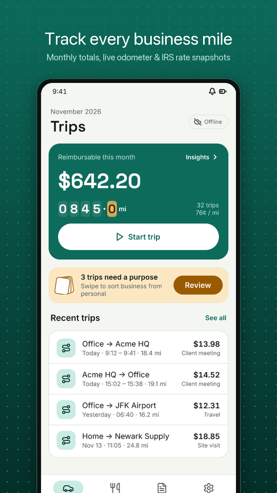<br />
      <sub><b>Home &amp; Odometer</b></sub>
    </td>
    <td align="center" width="25%">
      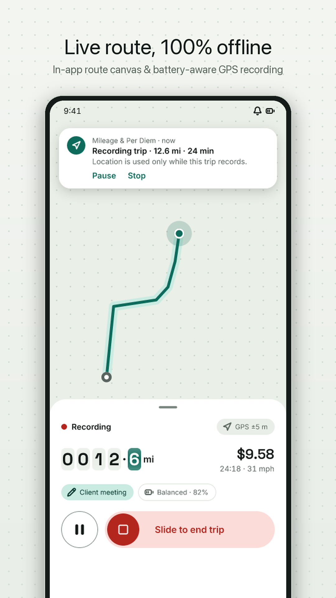<br />
      <sub><b>Offline Route Canvas</b></sub>
    </td>
    <td align="center" width="25%">
      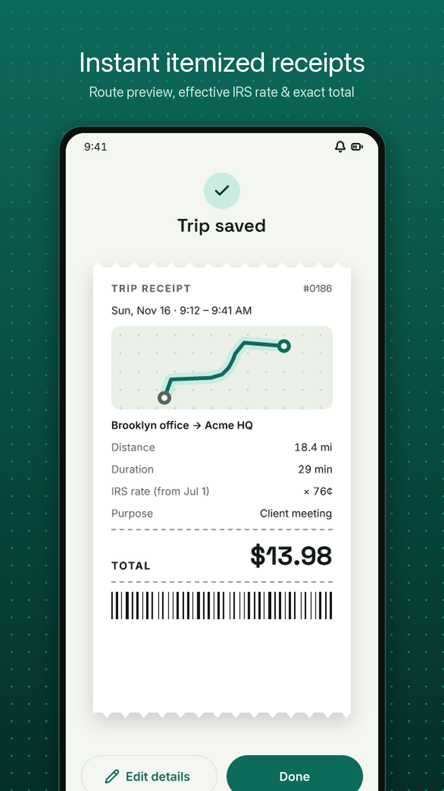<br />
      <sub><b>Itemized Trip Receipt</b></sub>
    </td>
    <td align="center" width="25%">
      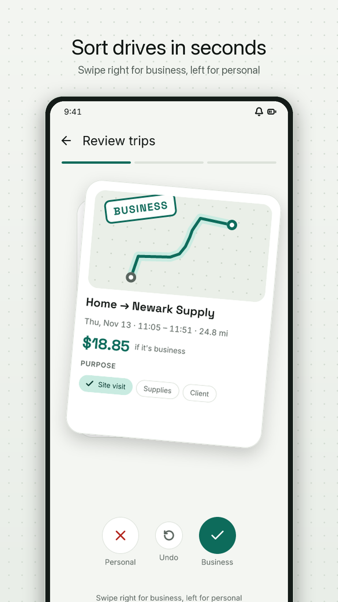<br />
      <sub><b>Swipe-to-Sort Deck</b></sub>
    </td>
  </tr>
  <tr>
    <td align="center" width="25%">
      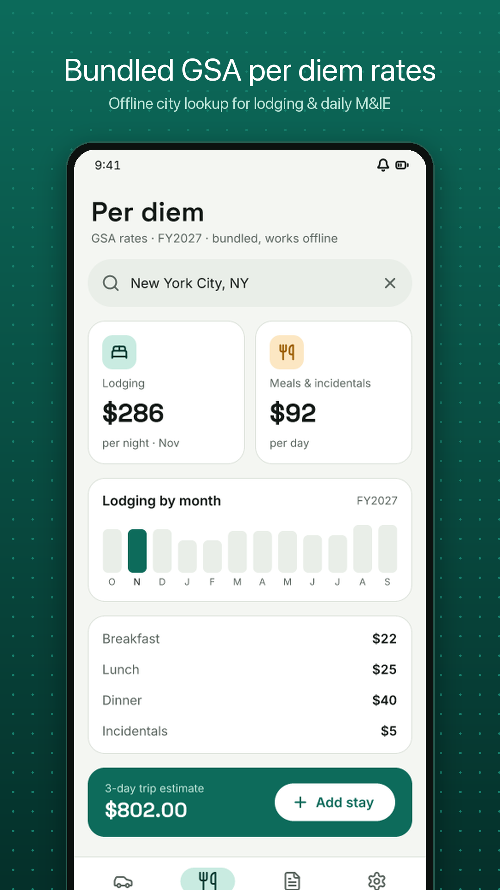<br />
      <sub><b>Bundled GSA Per Diem</b></sub>
    </td>
    <td align="center" width="25%">
      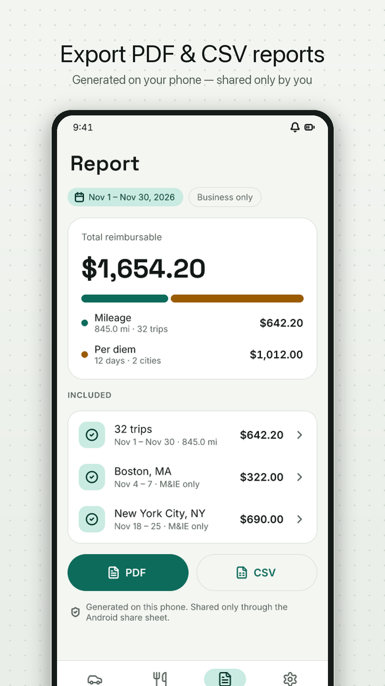<br />
      <sub><b>PDF &amp; CSV Export</b></sub>
    </td>
    <td align="center" width="25%">
      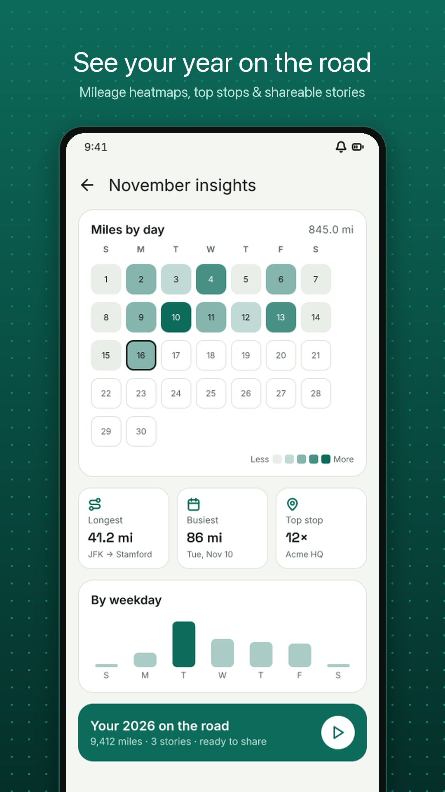<br />
      <sub><b>Monthly Insights</b></sub>
    </td>
    <td align="center" width="25%">
      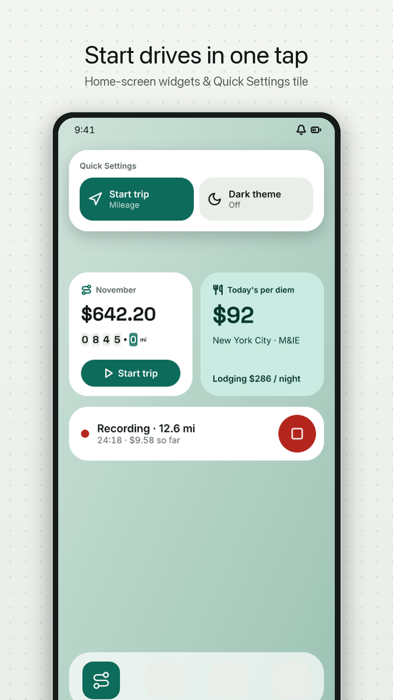<br />
      <sub><b>Widgets &amp; Quick Settings</b></sub>
    </td>
  </tr>
</table>
</div>

### Light & Dark Theme Craft (`design/renders/`)

Every screen is designed in **FigCraft** (`design/mileage-per-diem.figcraft`) with full Light and Dark theme parity.

<div align="center">
<table>
  <tr>
    <td align="center" width="50%">
      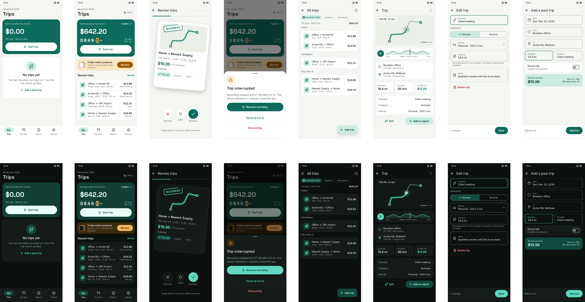<br />
      <sub><b>Trips &amp; Review Flow</b></sub>
    </td>
    <td align="center" width="50%">
      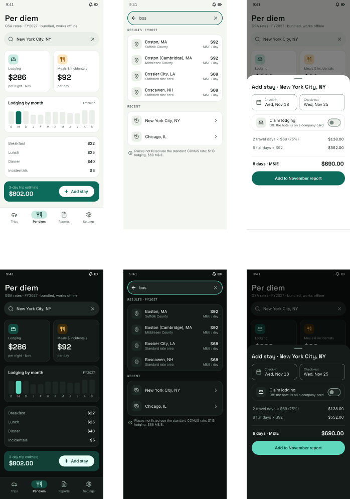<br />
      <sub><b>Per Diem &amp; Stays</b></sub>
    </td>
  </tr>
</table>
</div>

---

## Key Features

- **100% On-Device & Offline:** Zero backend, zero accounts, and **no `INTERNET` permission** — routes, trips, and reports stay on the phone.
- **Play-Policy-Compliant GPS Recording:** No `ACCESS_BACKGROUND_LOCATION`. Trips are user-started and recorded in a foreground `location` service (`FusedLocationProviderClient`), with an in-app `RouteCanvas` (no external map SDK).
- **Effective-Dated IRS Mileage Rates:** Snapshots the applicable IRS rate when a trip is saved (e.g., `72.5¢/mi` Jan–Jun 2026, `76¢/mi` Jul 2026+), plus custom vehicle rates.
- **Bundled GSA Per Diem Lookup:** Prepackaged `perdiem.db` for offline U.S. city lodging & Meals & Incidentals (M&IE) rates, including the 75% first/last travel day calculation.
- **Swipe-to-Sort & Printed Receipts:** Classify drives in seconds with a swipe deck and generate itemized trip receipts.
- **Local PDF & CSV Expense Reports:** Built with `PdfDocument` and RFC 4180 CSV, shared solely via the Android share sheet.
- **Insights, Stories & Widgets:** Monthly mileage calendar heatmap, shareable "Year on the Road" story cards, Glance home-screen widgets, and a Quick Settings tile.

---

## Architecture

The codebase follows a strict **Clean Architecture + MVVM / Unidirectional Data Flow (UDF)** split across feature and core modules, governed by repo-wide and module-level `AGENTS.md` contracts.

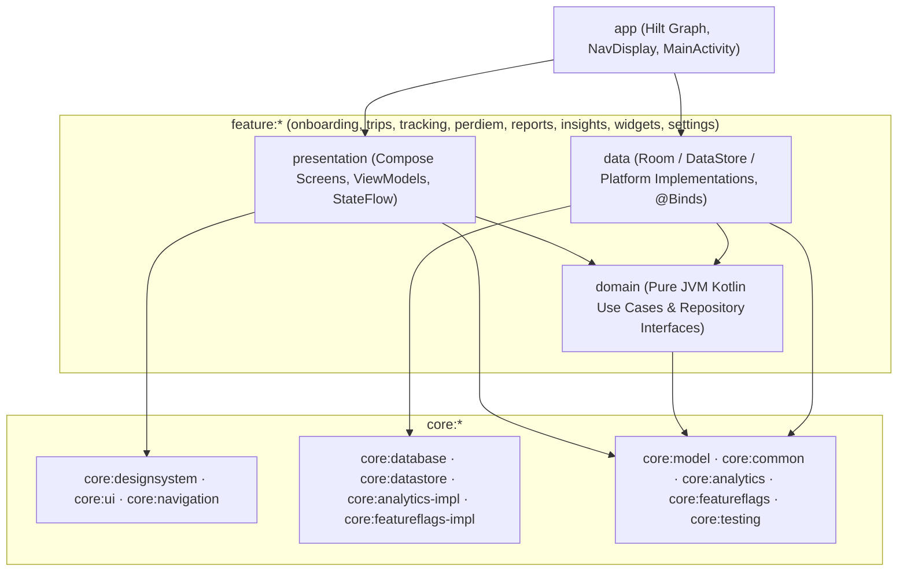

### Engineering Guardrails (`AGENTS.md`)

- **Strict Layer Boundaries:** `feature:x:domain` is pure JVM Kotlin; `presentation` calls use cases only (never repositories) and never depends on `data`.
- **Type-Safe Domain Primitives:** Currency uses `core.model.Money` (`Long` micro-dollars, never `Double`); distance uses `core.model.Distance`.
- **Fake-First Testing:** Tests use `testFixtures` fakes (`FakeAnalytics`, `FakeFeatureFlags`, `FakeClock`) rather than mocks.
- **Startup & Runtime Budget:** Baseline Profiles, R8 full mode, `dagger.Lazy` for non-critical initialization, and no main-thread startup work.

---

## Google Play Store Readiness

All store publishing materials are prepared in [`store-listing/`](store-listing/):

- **Listing Copy & Metadata:** [`store-listing/PLAY_STORE_LISTING.md`](store-listing/PLAY_STORE_LISTING.md) (app title, short & full descriptions, v1.0.0 release notes, Data Safety summary, and location policy disclosures)
- **Play Store Icon (512 × 512):** [`store-listing/assets/play_store_icon_512x512.png`](store-listing/assets/play_store_icon_512x512.png)
- **Feature Graphic (1024 × 500):** [`store-listing/assets/feature_graphic_1024x500.png`](store-listing/assets/feature_graphic_1024x500.png)
- **8 Phone Screenshots (1080 × 1920):** [`store-listing/assets/screenshots/`](store-listing/assets/screenshots/)
- **Adaptive Launcher Icon:** Configured in `app/src/main/res/mipmap-anydpi-v26/ic_launcher.xml` with background, foreground, monochrome layer, and `mdpi`–`xxxhdpi` mipmaps.

---

## Common Commands

```bash
# Run JVM domain unit tests
./gradlew :feature:trips:domain:test

# Run Android presentation unit tests
./gradlew :feature:trips:presentation:testDebugUnitTest

# Install debug build on connected device/emulator
./gradlew :app:installDebug

# Run startup benchmark
./gradlew :benchmark:connectedBenchmarkReleaseAndroidTest
```

---

## Further Reading

- [`AGENTS.md`](AGENTS.md) — Agent rules, layer constraints, and UI/accessibility standards
- [`docs/ARCHITECTURE.md`](docs/ARCHITECTURE.md) — Module graph, use cases, tech stack, and screen inventory
- [`docs/ANALYTICS.md`](docs/ANALYTICS.md) — On-device analytics catalog, dashboards, and feature flags
- [`docs/adr/`](docs/adr/) — Architecture Decision Records
