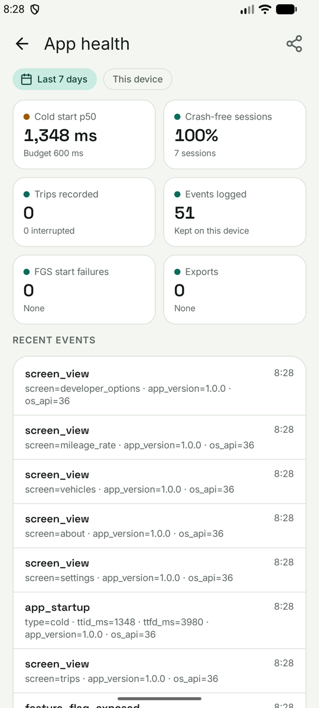
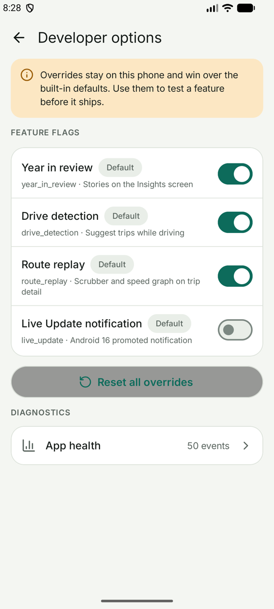
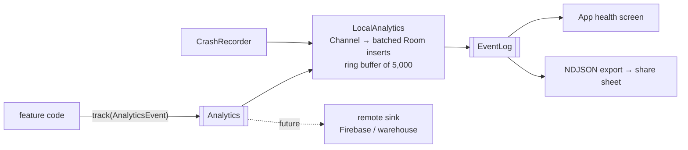

# Analytics, app health and feature flags without a backend

> **TL;DR:** Typed analytics events are written to an on-device ring buffer behind an `Analytics` interface. They feed an in-app **App health** dashboard and export as NDJSON. **Feature flags** default in code, can be overridden on the device, and record when each flag is first read in a session.

  
  

## Events built for dashboards
Each event has a snake_case name and typed parameters (`AnalyticsEvent` is a sealed class), so a mistyped event name won't compile. Examples: `app_startup{type, ttid_ms, ttfd_ms}`, `trip_recording_stopped{distance_mi, duration_s, fixes, dropped_fixes, interrupted}`, `trip_recording_failed{reason}`, `export_completed{format, trips, duration_ms}`, `feature_flag_exposed{flag, value, source}`, `app_crash{exception, thread}`.

| Dashboard | Signal | Alert |
|---|---|---|
| Startup | p50/p90 TTID by version | p50 > 600 ms |
| Stability | crash-free sessions | < 99.5% |
| Recording reliability | start failures, interrupted trips, dropped-fix ratio | failure rate > 2% |
| Permissions funnel | onboarding → location → precise → notifications | precise grants drop > 10% |

Full catalog and dashboard spec: [`docs/ANALYTICS.md`](../../docs/ANALYTICS.md). **Privacy:** events never contain coordinates, place names or free text.

## Feature flags
`FeatureFlag` (pure Kotlin) defines each flag with a default. `DataStoreFeatureFlags` resolves **local override → default**; a remote-config source can slot in between later. Flags are exposed as `Flow<Boolean>`, so toggling one in Developer options updates open screens immediately.

| Flag | Default | Turns on |
|---|---|---|
| `year_in_review` | on | "2026 on the road" stories on Insights |
| `drive_detection` | on | Activity Recognition trip suggestions |
| `route_replay` | on | Scrubber and speed graph on trip detail |
| `live_update` | off | Android 16 promoted notification while recording |

Every flag is tested both ways with `FakeFeatureFlags`.

**Decisions:** [ADR 0015 on-device analytics](../../docs/adr/0015-on-device-analytics-with-a-pluggable-sink.md) · [0016 feature flags](../../docs/adr/0016-feature-flags-with-local-overrides.md)
