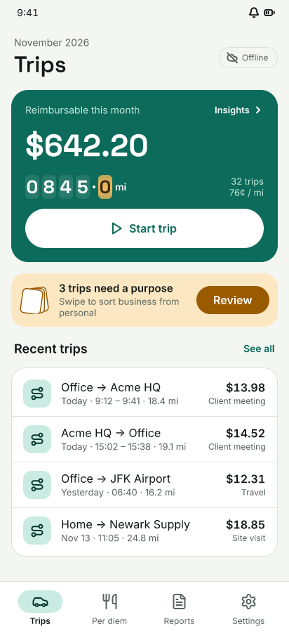
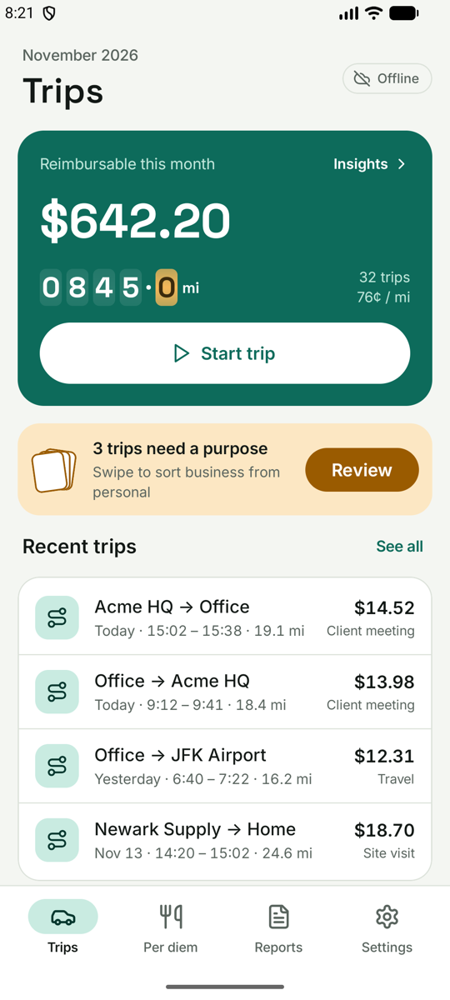
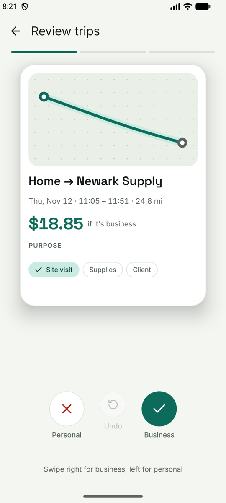
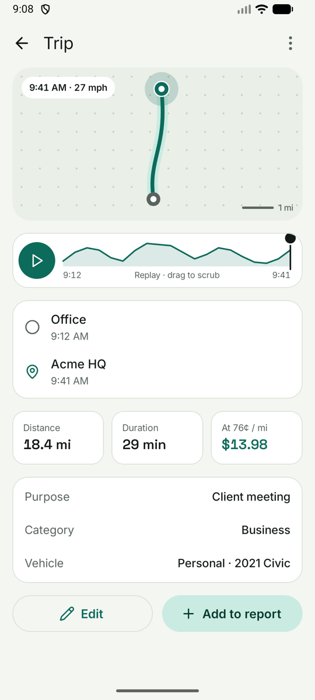
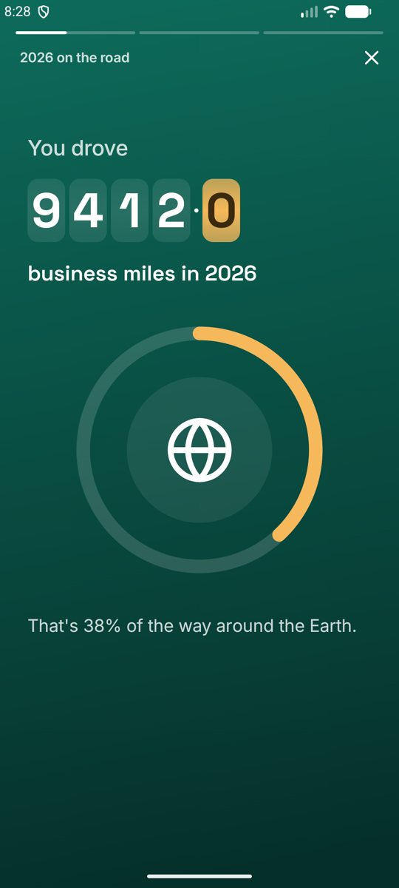
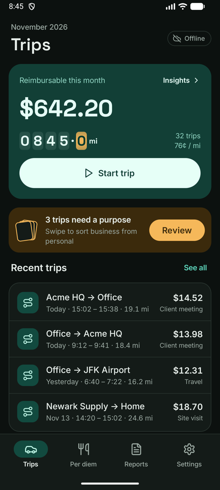

# From FigCraft design to Compose

> **TL;DR:** Every screen was designed in FigCraft *before* any code was written: 34 designs (67 frames in light and dark) covering every page, widget and motion spec. This module turns those designs into tokens and components, and features may only build UI from them.

<table align="center">
  <tr>
    <td align="center"> Design (FigCraft)</td>
    <td align="center"> App on the API 36 emulator</td>
  </tr>
</table>

## Tokens to components
- **Colour roles** (`MpdTheme.colors`): bg, surface, primary and containers, accent (amber), danger, hero, map. Light and dark sets come straight from the design file, and dynamic colour is off to keep the brand.
- **Type** (`MpdTheme.type`): Space Grotesk for display and numbers, Inter for body text. Both are variable fonts **subset to Latin (880 KB → 112 KB)**, and amounts use tabular figures.
- **Icons:** 47 Lucide icons converted to vector drawables; no icon-pack dependency.
- **Components:** `MpdButton`, `MpdCard`, `MpdListRow`, `ValueRow`, `MpdChip`, `SegmentedControl`, `MpdField`, `MpdTopBar`, `MpdNavBar`, `SaveBar`, `Odometer`, and more. The root [`AGENTS.md`](../../AGENTS.md) forbids hard-coded colours in feature code.

## UI-craft moments
| Moment | How it's built |
|---|---|
| **Odometer** | One `AnimatedContent` per digit, so only changed digits roll. The amber tenths drum comes from a car odometer. One merged semantics node reads "845.0 miles". [`Odometer.kt`](src/main/kotlin/com/aijones/mileage/core/designsystem/component/Odometer.kt) |
| **Route canvas** (no map SDK) | Projects GPS points onto a dot grid with a halo, pins, labels and an auto-scaled scale bar; can draw on and replay a route. [`RouteCanvas.kt`](../ui/src/main/kotlin/com/aijones/mileage/core/ui/RouteCanvas.kt) |
| **Slide to end trip** | `AnchoredDraggable` with haptic ticks, plus an "End trip" accessibility action so nobody has to drag. [`SlideToEnd.kt`](../../feature/tracking/presentation/src/main/kotlin/com/aijones/mileage/feature/tracking/presentation/SlideToEnd.kt) |
| **Printed receipt** | Zigzag `GenericShape`, Canvas perforations and barcode, and a spring clip-reveal that "prints" it. [`TripReceiptScreen.kt`](../../feature/tracking/presentation/src/main/kotlin/com/aijones/mileage/feature/tracking/presentation/TripReceiptScreen.kt) |
| **Swipe deck** | Rotation follows the drag, a BUSINESS/PERSONAL stamp fades in, and the card flings out with the drag's velocity. [`ReviewScreen.kt`](../../feature/trips/presentation/src/main/kotlin/com/aijones/mileage/feature/trips/presentation/ReviewScreen.kt) |
| **Year in review** | Auto-advancing story pager, paused under TalkBack. The share image is captured on-device with `rememberGraphicsLayer()`. |

  
  
  
  

**Accessibility baseline:** 48 dp touch targets (clickable chips included), content descriptions on icon buttons, live regions for trip stats, and custom actions for every gesture. Layouts are built to reflow at 2× font scale.

**Source designs:** [`design/mileage-per-diem.figcraft`](../../design/) · renders in [`design/renders/`](../../design/renders) · **Decision:** [ADR 0011 no map SDK](../../docs/adr/0011-no-map-sdk-in-app-route-canvas.md)
