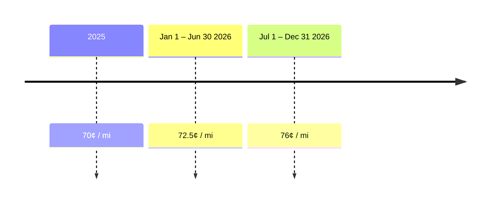

# Money, distance and rates that change mid-year

> **TL;DR:** Money is stored as `Long` micro-dollars and distance in meters with tenth-of-a-mile rounding. Each trip snapshots the IRS rate in effect on its date, because in 2026 the rate changed in July.

## The real-world wrinkle
The IRS set the 2026 business rate at **72.5¢/mi** (Notice 2026-10), then raised it to **76¢/mi from July 1** (Announcement 2026-11) because of fuel prices. An app that stores "the 2026 rate" gets every trip from one half of the year wrong.



- [`BundledMileageRateRepository`](../../feature/trips/data/src/main/kotlin/com/aijones/mileage/feature/trips/data/BundledMileageRateRepository.kt) holds an **effective-dated** table. A company rate from Settings overrides it.
- When a trip is saved, its rate is **copied onto the trip**. Later rate changes never rewrite history, so a report from March reproduces exactly.
- The year-in-review splits totals by rate period: *4,980 mi × 72.5¢ + 4,432 mi × 76¢*.

## No floating-point money
```kotlin
@JvmInline value class Money(val micros: Long)          // $13.98 == Money(13_980_000)
fun mileageAmount(distance: Distance, rate: Money) =     // 18.4 mi × 76¢ = $13.98
    Money(Math.round(distance.tenthsOfMile * rate.micros / 10.0))
```
- Inline value classes cost nothing at runtime.
- Rounding happens once, half-up to cents, at display or export time.
- Per diem uses the GSA rule of **75% M&IE on the first and last travel day** ([`PerDiemCalculator`](../../feature/perdiem/domain/src/main/kotlin/com/aijones/mileage/feature/perdiem/domain/PerDiemCalculator.kt)). New York City, Nov 18–25: 2 × $69 + 6 × $92 = **$690**.

**Tests:** `MoneyAndDistanceTest` (rounding, formatting, haversine), rate-boundary tests for Jun 30 vs Jul 1 in `feature/trips/domain`, and month-boundary lodging tests for per diem.

**Decisions:** [ADR 0009 effective-dated rates](../../docs/adr/0009-effective-dated-mileage-rates-with-a-per-trip-snapshot.md) · [0010 Money as micros](../../docs/adr/0010-money-as-long-micro-dollars.md)
