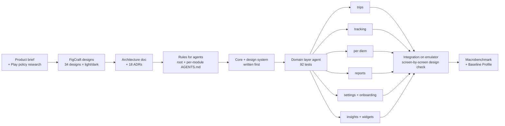

# How this was built: design-first, with coding agents

> **TL;DR:** AI.Jones acted as product owner, designer and tech lead, and coding agents did most of the typing. Designs and architecture were approved before any code, rules were written down for agents to follow, and every change was checked on a real emulator.

## The process
1. **Research first.** Google Play's rules for location, foreground services, data safety and closed testing were researched with citations ([`PLAY_PUBLISHING.md`](PLAY_PUBLISHING.md)). The research changed the product: trips are user-started, with no background location.
2. **Design before code.** Every page, widget and motion detail was designed in FigCraft in light and dark ([`design/`](../design)). Agents compared their Compose previews against these renders.
3. **Decisions written down.** [`ARCHITECTURE.md`](ARCHITECTURE.md) and [18 ADRs](adr/) record each choice and the alternatives. [`AGENTS.md`](../AGENTS.md) turns them into hard rules: no code comments, use cases only, fakes not mocks, design-system components only, `Money` never `Double`.
4. **Contracts before features.** Core modules and the whole domain layer (with its fakes) came first. The six feature teams then built against stable interfaces.
5. **Parallel, isolated agents.** Six agents each worked in their own copy of the repo and returned only their modules, so no two of them touched the same files. Changes they needed outside their own modules came back as precise requests, which the lead applied.
6. **Verification on a device.** Every screen was driven on an API 36 emulator in light and dark and compared with its design. Mock GPS drives exercised recording, killing the app tested recovery, and the PDF was rendered and checked. Bugs found this way were fixed with tests, for example the widget odometer losing its last digit to Glance's 10-child limit, and unreviewed trips being counted as reimbursable.

## Artefacts you can inspect
| | |
|---|---|
| Product + Play policy | [`PLAY_PUBLISHING.md`](PLAY_PUBLISHING.md) · [`../store-listing/`](../store-listing/PLAY_STORE_LISTING.md) |
| Designs | [`../design/renders/`](../design/renders) |
| Architecture | [`ARCHITECTURE.md`](ARCHITECTURE.md) · [`adr/`](adr/) |
| Agent rules | [`../AGENTS.md`](../AGENTS.md), plus one `AGENTS.md` in each of the 37 modules |
| Analytics spec | [`ANALYTICS.md`](ANALYTICS.md) |
