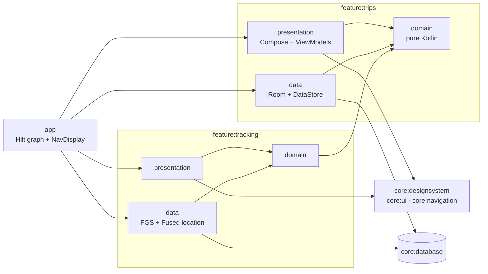

# Architecture: feature modules × clean layers

> **TL;DR:** 37 Gradle modules. Each feature splits into a pure-Kotlin `domain`, an Android `data` layer and a Compose `presentation` layer. ViewModels only call use cases, and the build fails if a module breaks the dependency rules.



## The rules
| Layer | May depend on | Never |
|---|---|---|
| `feature:x:domain` (JVM) | `core:model`, `core:common`, `core:analytics`, `core:featureflags`, other features' **domain** (acyclic) | Android, `data`, `presentation` |
| `feature:x:data` | its own domain, `core:database`, `core:datastore` | other features' `data` |
| `feature:x:presentation` | its own domain, core UI modules | any `data`, other features' presentation |
| `app` | everything (it's the composition root) | — |

Domain dependencies flow one way: `settings → trips`, `tracking → trips + settings`, `reports → trips + perdiem + settings`, `insights → trips + perdiem`.

## One screen, end to end
```kotlin
class StartTripUseCase @Inject constructor(
    private val trips: TripRepository,          // interface in trips:domain, Room in trips:data
    private val controller: RecordingController, // interface in tracking:domain, foreground service in tracking:data
    private val analytics: Analytics,
    private val clock: Clock,
) {
    suspend operator fun invoke(source: TripSource): Long { ... }
}
```
`LiveTripViewModel` calls `StartTripUseCase` and exposes a single `StateFlow<LiveTripUiState>`. `LiveTripScreen(state, onEnd)` is stateless, so it can be previewed, screenshotted and tested on the JVM.

## Why this shape
- **Fast feedback:** 99 domain tests run on the plain JVM in seconds, with no emulator or Robolectric.
- **Parallel work:** six coding agents built six features at once without touching each other's code (see [`docs/README.md`](../docs/README.md)).
- **Swappable edges:** the location source, rate tables and analytics sink are all interfaces with in-memory fakes.

**Where to look:** [`build-logic/convention`](../build-logic/convention/src/main/kotlin) (8 convention plugins) · [`core/navigation/Routes.kt`](../core/navigation/src/main/kotlin/com/aijones/mileage/core/navigation/Routes.kt) (Navigation 3 keys) · any module's `AGENTS.md`.

**Decisions:** [ADR 0002 modules](../docs/adr/0002-modules-by-feature-with-clean-architecture-layers.md) · [0003 use cases](../docs/adr/0003-use-cases-as-the-only-path-from-viewmodel-to-data.md) · [0004 Hilt](../docs/adr/0004-hilt-for-dependency-injection.md) · [0005 Navigation 3](../docs/adr/0005-navigation-3-with-typed-keys-in-corenavigation.md)
