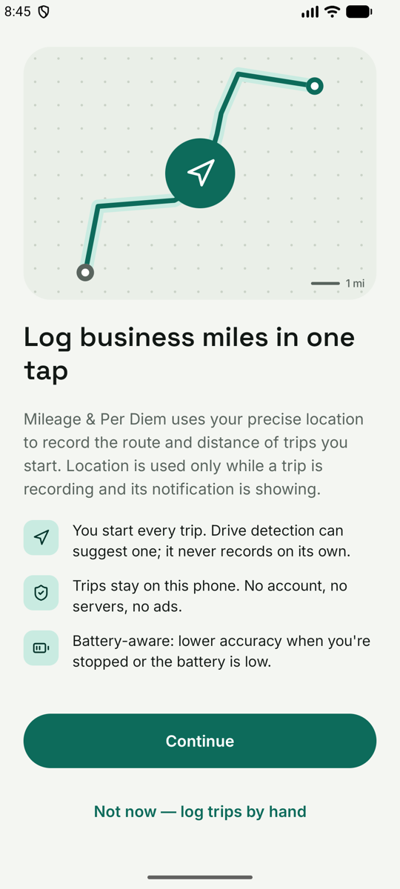
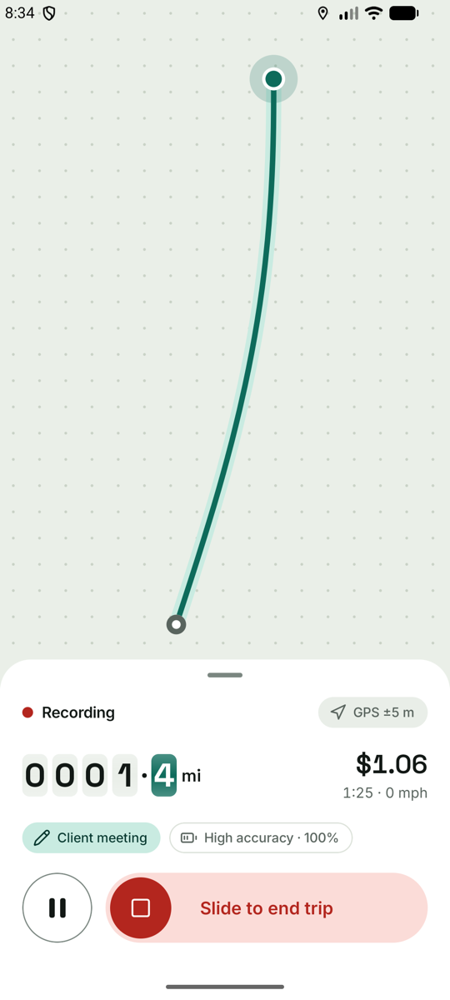
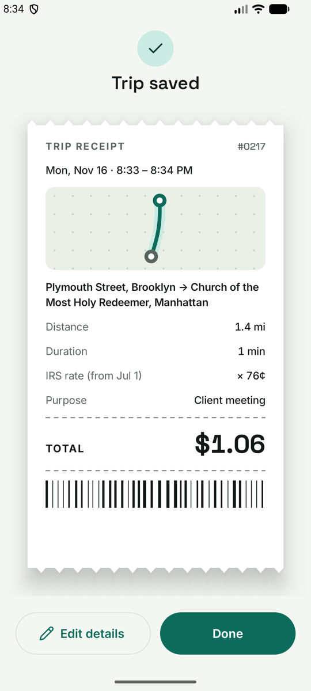
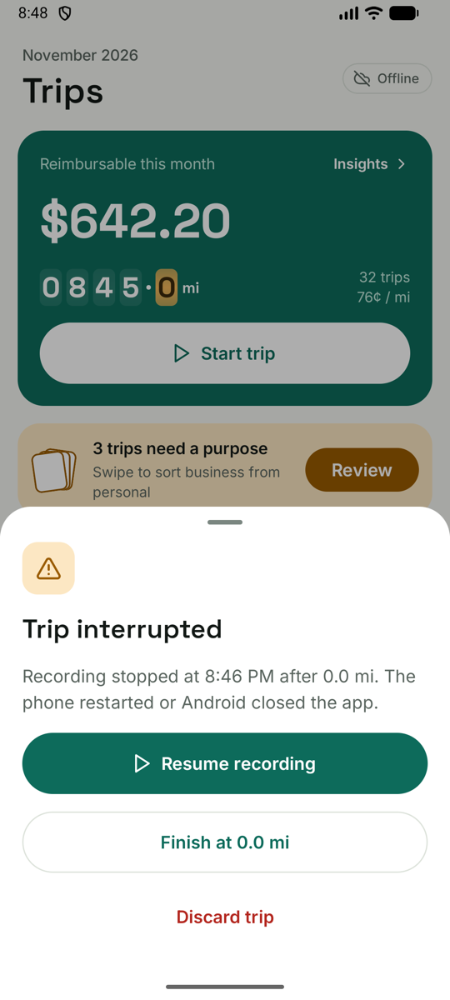
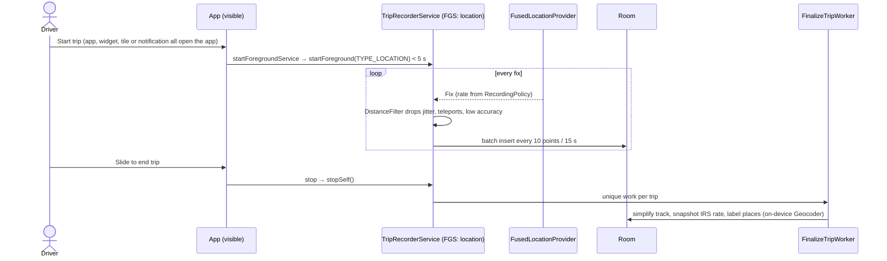

# Trip recording that passes Play review

> **TL;DR:** GPS recording runs in a `location` foreground service the user starts. There is no `ACCESS_BACKGROUND_LOCATION`, the app has no `INTERNET` permission, and a battery-aware sampling policy picks the GPS rate.

  
  
  
  

## The flow

## Engineering decisions
- **Policy first.** Fully automatic logging would need background location, which brings a declaration form, a demo video and a high rejection risk. Instead, "drive detection" (Activity Recognition) only **suggests** a trip with a notification. The user always taps to start, so every start comes from visible UI. `./gradlew :app:verifyNoForbiddenPermissions` (part of `check`) fails if the merged manifest ever asks for background location or internet.
- **Battery policy** ([`RecordingPolicyResolver`](domain/src/main/kotlin/com/aijones/mileage/feature/tracking/domain/RecordingPolicyResolver.kt), pure and unit-tested):

  | State | Accuracy | Interval |
  |---|---|---|
  | Moving | high | 2 s / 5 m |
  | Stopped > 2 min | balanced | 15 s / 25 m |
  | Power-save or ≤ 20% battery | balanced | 10 s / 20 m |

  Updates are re-requested only when the policy changes.
- **Correct distance.** [`DistanceFilter`](domain/src/main/kotlin/com/aijones/mileage/feature/tracking/domain/DistanceFilter.kt) rejects fixes with accuracy over 35 m, implied speeds over 70 m/s, and jitter while stationary. [`TrackSimplifier`](domain/src/main/kotlin/com/aijones/mileage/feature/tracking/domain/TrackSimplifier.kt) (Douglas–Peucker) shrinks storage while keeping distance within 0.5%.
- **Process death.** If Android kills the app, the trip stays `RECORDING` in Room. The next launch shows an *Interrupted trip* sheet (resume, finish or discard), so no trip is ever silently lost.
- **Testable core.** The pipeline lives in [`RecordingSession`](data/src/main/kotlin/com/aijones/mileage/feature/tracking/data/RecordingSession.kt), a plain class driven by a fake location tracker in tests. The service is a thin shell around it.

**Decisions:** [ADR 0007 user-initiated trips](../../docs/adr/0007-user-initiated-trips-no-background-location.md) · [0008 battery policy](../../docs/adr/0008-battery-aware-location-policy.md) · [Play publishing research (cited)](../../docs/PLAY_PUBLISHING.md)
