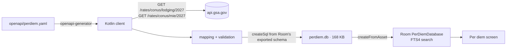
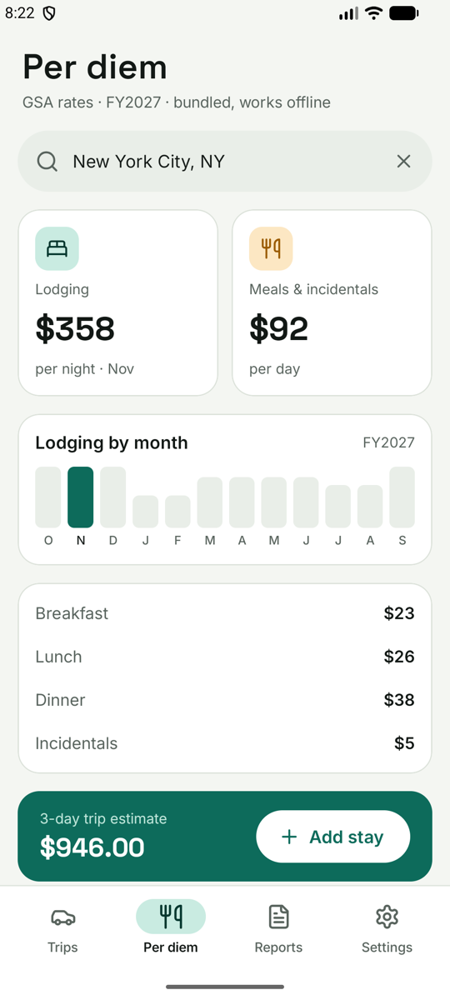
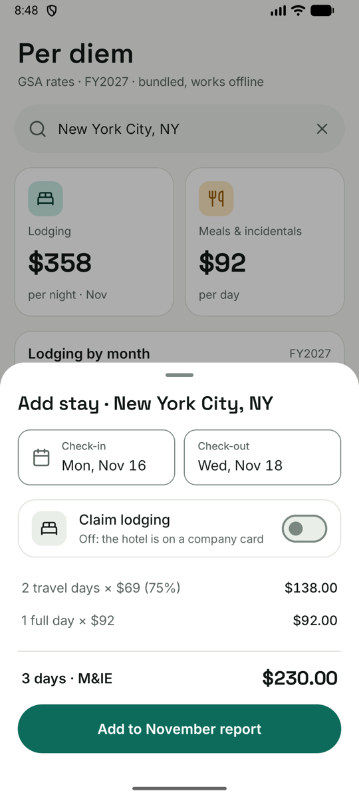

# Offline GSA per diem: contract-first import at build time

> **TL;DR:** A JVM tool generates a client from an OpenAPI spec, pulls FY2027 rates from the GSA Per Diem API, and writes a 168 KB SQLite asset that Room opens with `createFromAsset`. The app itself never touches the network.

| | |
|---|---|
| Locations | **298** non-standard CONUS areas, plus the standard rate ($113 lodging / $68 M&IE) |
| Lodging | Monthly rates (NYC November = $358 a night) |
| M&IE tiers | 5, each with breakfast, lunch, dinner, incidentals and the 75% first/last-day amount |
| Search | FTS4 prefix search on city, state and county; unknown places fall back to the standard rate |

  
  

## Why it's built this way
- **No backend, no `INTERNET`.** Rates change once a fiscal year (Oct 1), so shipping them inside the app is both accurate and private.
- **Contract-first.** GSA's published spec has no response schemas and leaves out the M&IE endpoint, so [`openapi/perdiem.yaml`](openapi/perdiem.yaml) is a trimmed version with schemas added for the two endpoints we use.
- **Schema-safe.** The tool builds tables from Room's exported schema, identity hash included, so the asset can never drift from the `@Entity` classes. A test opens the real asset through Room.

Regenerate yearly with `./gradlew :tools:perdiem-import:run`.

**Decision:** [ADR 0012 build-time GSA import](../../docs/adr/0012-bundled-gsa-per-diem-data-via-a-build-time-openapi-import.md)
